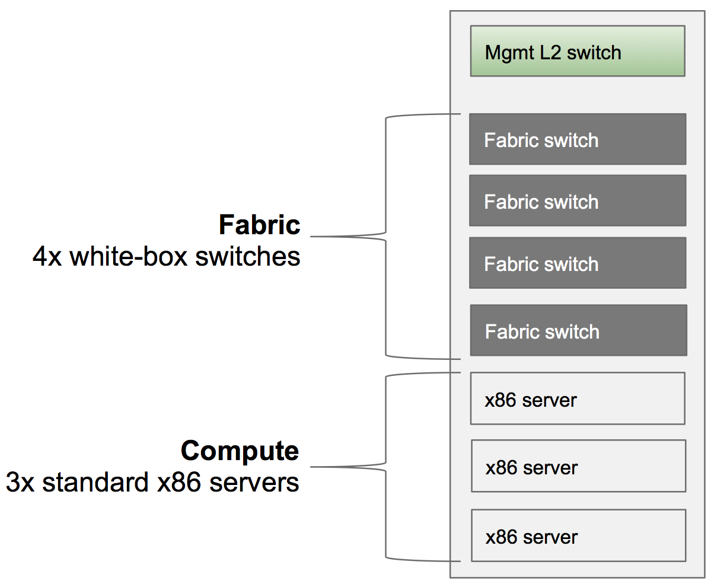
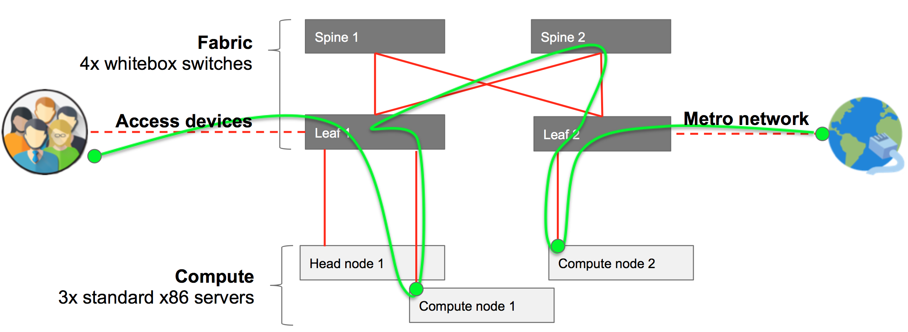
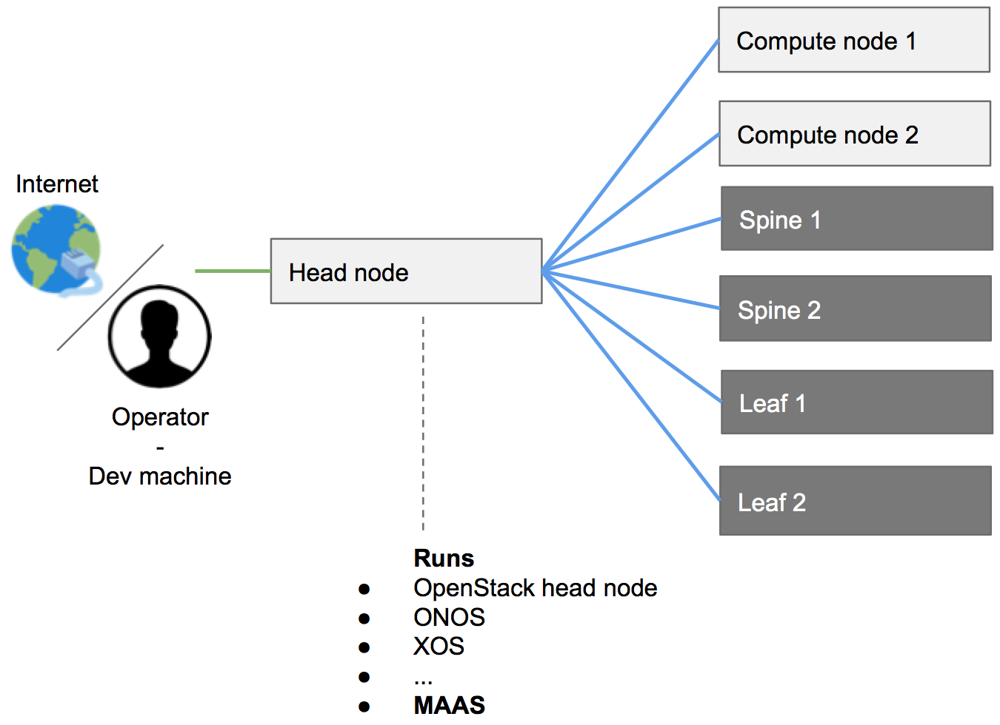
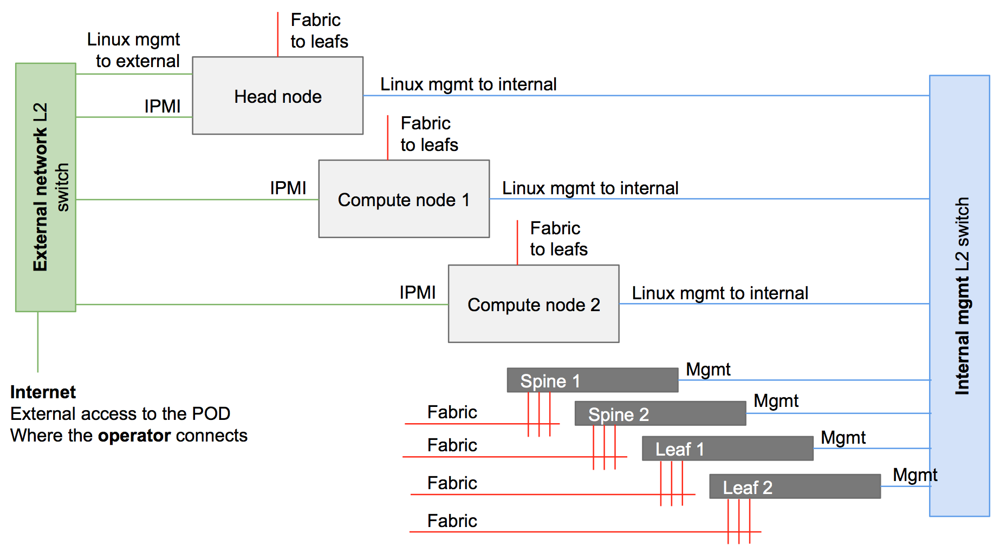

#Installing a CORD POD

This section gives a detailed, step-by-step recipe for installing a physical POD.

>NOTE: If you are new to CORD and would like to get familiar with it, you should 
>start by bringing up a development POD on a single physical server, called 
>[CORD-in-a-Box](quickstart.md).

>NOTE: Also see the [Quick Start: Physical POD](quickstart_physical.md) Guide
>for a streamlined overview of the physical POD install process.

##Terminology

This guide uses the following core concepts terminology.

* **POD**: A single physical deployment of CORD.

* **Full POD**: A typical configuration, and is used as example in this Guide.
A full CORD POD is composed by three servers, and four fabric switches.
It makes it possibile to experiment with all the core features of CORD and it
is what the community uses for tests.

* **Half POD**: A minimum-sized configuration. It is similar to a full POD, but with less hardware. It consists of two servers (one head node and one compute node), and one fabric switch. It does not allow experimentation with all of the core features that
CORD offers (e.g., a switching fabric), but it is still good for basic experimentation and testing.

* **Development / Management Node**: Also referred to as a "dev node,"
this is the machine used to download, build and deploy CORD onto a POD.
Sometimes it is a dedicated server, and sometime the laptop of the deployer.
In principle it can be any machine that satisfies the hardware and software
requirements reported below.

* **Development (dev) VM**: Bootstrapping the CORD installation requires a lot of
software to be installed and some non-trivial configurations to be applied.
All this should mainly happen on the development/management node.
To help users with the process, CORD provides an easy way to create on the
dev node a VM with all the software required and the configurations in place.
This guide and the community often refers to it as the "dev VM."

* **Head Node**: One of the servers in a POD that runs management services
for the POD. This includes XOS (the orchestrator), two instances of ONOS
(the SDN controller, one to control the underlay fabric, one to control the overlay),
MaaS and all the services needed to automatically install and configure the rest of
the POD devices.

* **Compute Node(s)**: A server in a POD that run VMs or containers associated with
one or more tenants. The terminology is borrowed from OpenStack.

* **Fabric Switch**: A switch in a POD that interconnects other switch and server
elements inside the POD.

* **vSG**: The virtual Subscriber Gateway (vSG) is the CORD counterpart for existing
CPEs. It implements a bundle of subscriber-selected functions, such as Restricted Access, Parental Control, Bandwidth Metering, Access Diagnostics and Firewall. These functionalities run on commodity hardware located in the Central Office rather than on the customer’s premises. There is still a device in the home (which we still refer to as the CPE), but it has been reduced to a bare-metal switch. 

## Overview of a CORD POD

The following is a brief description of a generic full POD.

###Physical Configuration

A full POD includes a ToR management switch, four fabric switches and three
standard x86 servers. The following figure does not show access devices
or any upstream connectivity to the metro network; those details are included
later in this section.



###Logical Configuration: Data Plane Network

The following diagram is a high level logical representation of a typical CORD POD.



The figure shows 40G data plane connections (red), where end-user traffic goes
from the access devices to the metro network (green). User traffic goes through different different leafs, spines and compute nodes, depending on the services
needed, and where they are located. The switches form a leaf and spine fabric.
The compute nodes and the head node are connected to a port of one of the
leaf switches. 

###Logical Configuration: Control Plane / Management Network

The following diagram shows in blue how the components of the system are
connected through the management network.



As shown in this figure, the head node is the only server in the POD connected both
to Internet and to the other components of the system. The compute nodes and the switches are only connected to the head node, which provides them with all the software needed.

##Sample Workflow

It is important to have a general picture of installation workflow before
getting into the details. The following is a list of high-level tasks involved
in bringing up a CORD POD:

* CORD software gets downloaded and built on the dev machine.
* A POD configuration is created by the operator on the dev machine.
* The software is pushed from the dev machine to the head node.
* The software gets automatically deployed from the head node to the compute nodes.
* Compute nodes and fabric switches need to be manually rebooted. The CORD
build procedure automatically installs the OS, other software needed and performs
the related configurations.

##Requirements

While the CORD project is for openness and does not have any interest in sponsoring specific vendors, it provides a reference implementation for both hardware and software to help users in building their PODs. What is reported below is a list of hardware that, in the community experience, has worked well.

Also note that the CORD community will be better able to help you debugging issues if your hardware and software configuration look as much as possible similar to the ones reported in the reference implementation, below.

##Bill Of Materials (BOM) / Hardware Requirements

The section provides a list of hardware required to build a full CORD POD.

###BOM Summary

| Quantity | Category | Brand              | Model                            | Part Num          |
|--------|--------|------------|-------------------|-------------|
| 3             | Compute | Quanta (QCT) | QuantaGrid D51B-1U     | QCT-D51B-1U |
| 4             | Fabric Switch | EdgeCore | AS6712-32X                  | AS6712-32X    |
| 1             | Management Switch (L2 VLAN support) | * | * | *                        |
| 7             | Cabling (data plane) | Robofiber | QSFP-40G-03C | QSFP-40G-03C |
| 12           | Cabling (Mgmt) | CAT6 copper cables 3M) | * | * |

###Detailed Requirements

* 1x development/management machine. It can be either a physical machine or a virtual machine, as long as the VM supports nested virtualization. It doesn’t have to be necessarily Linux (used in the rest of the guide, below); in principle anything able to satisfy the hardware and the software requirements. Generic hardware requirements are 2 cores, 4G of memory, 60G of hdd.

* 3x physical machines: one to be used as head node, two to be used as compute nodes.

   * Model suggested: OCP-qualified QuantaGrid D51B-1U server. Each server is configured with 2x Intel E5-2630 v4 10C 2.2GHz 85W, 64GB of RAM 2133MHz DDR4, 2x hdd500GB and a 40 Gig adapter.

   * Strongly suggested fabric NIC:
       * Intel Ethernet Converged Network Adapters XL710 10/40 GbE PCIe 3.0, x8 Dual port.
       * ConnectX®-3 EN Single/Dual-Port 10/40/56GbE Adapters w/ PCI Express 3.0.
	   >NOTE: while the machines mentioned above are generic standard x86 servers, and can be potentially substituted with any other machine, it’s quite important to stick with either one of the network card suggested. CORD scripts will look for either an i40e or a mlx4_en driver, used by the two cards cards. To use other cards additional operations will need to be done. Please, see the network configuration appendix for more info.
	   
* 4x fabric switches
     * Model suggested: OCP-qualified Accton 6712 switch. Each switch is configured with 32x40GE ports - produced by EdgeCore and HP.

* 7x fiber cables with QSFP+ (Intel compatible) or 7 DAC QSFP+ (Intel compatible) cables

     * Model suggested: Robofiber QSFP-40G-03C QSFP+ 40G direct attach passive copper cable, 3m length - S/N: QSFP-40G-03C.

* 1x 1G L2 copper management switch supporting VLANs or 2x 1G L2 copper management switches

##Connectivity Requirements

The dev machine and the head node have to download a large quantity of software from different sources on the Internet, so they need to be able to fully reach Internet. Usually, firewalls, proxies, and software that prevents to access local DNSs generate issues and should be avoided.

##Cabling a POD

This section describes how the building hardware components should be connected together to form a fully functional CORD POD.

### Management / Control Plane Network

The management network is divided in two broadcast domains: one connecting the POD to the Internet and giving access to the deployer (called “external” and shown in green in the figure below), and one called “internal” or “management” and shown in blue. For completeness, the diagram also shows data plane connections in red (as described
in the next paragraph).



The external and the management networks can be separated either using two different switches, or the same physical switch and by using VLANs.

> NOTE: Head node IPMI connectivity is optional.

>NOTE: IPMI ports do not have to be necessarily connected to the external network. The requirement is that compute node IPMI interfaces need to be reachable from the head node. This is possible also through the internal / management network.

>NOTE: Often, vendors allow to use a shared management port to provide IPMI functionalities. One of the NICs used for system management (called eth0 for example in the operating system) can be shared, to be used at the same time also as IPMI port.

####External Network

The external network allows the POD to go to the Internet, and operators to access the POD. Usually, operators want to be able to directly start/stop/reboot the head and the compute nodes from this network. Moreover, using CORD automated scripts and tools for Jenkins pipeline requires Jenkins direct access to these interfaces. This is why IPMI/BMC interfaces of the nodes are also connected to the external network.
In summary, following is the list of equipment/interfaces usually connected to the external network:

* Internet
* Dev machine
* Head node - 1x 1G interface (following defined as external)
* Head node - 1x IPMI/BMC interface (optional)
* Compute node 1 - 1x IPMI/BMC interface (optional, strongly suggested for a proper CORD installation)
* Compute node 2 - 1x IPMI/BMC interface (optional, strongly suggested for a proper CORD installation)

####Internal Network

The internal/management network is separate from the external one. It has the goal to connect the head node to the rest of the system components (compute nodes and fabric switches). For a typical POD, the internal network includes:

* Head node - 1x 1G interface (following defined as management)
* Compute node 1 - 1x 1G interface
* Compute node 2 - 1x 1G interface
* Fabric 1 - management interface
* Fabric 2 - management interface
* Fabric 3 - management interface
* Fabric 4 - management interface

###User / Data Plane Network

The data plane network (represented in red in the figure) carries user traffic (in green), from the access devices to the point the POD connects to the metro network.

**Figure**

The fabric switches form a classic leaf and spine topology. A typical full
POD has two leafs and two spines. Currently, this is a pure 40G network.
While spines are not connected together, each leaf is connected to both spines.
In summary, the following are the devices connecting to the leaf switches:

* Head node  - 1x 40G interface
* Compute node 1 - 1x 40G interface
* Compute node 2 - 1x 40G interface
* Access devices - 1 or more 40G interfaces
*Metro devices - 1 or more 40G interfaces

###Best Practice

The community follows a set of best practices to better be able to remotely debug issues, for example via mailing-lists. The following is not mandatory, but is strongly suggested:

* Leaf nodes are connected to the spines nodes starting at the highest port number on the leaf.

* For a given leaf node, its connections to the spine nodes terminate on the same port number on each spine.

* Leaf _n_ connections to spine nodes terminate at port _n_ on each spine node.

* Leaf-spine switches are connected into the management TOR starting from the highest port number.

* Compute node _n_ connects to the internal (management) network switch on port _n_.

* Compute node _n_ connects to its leaf at port _n_.

* The head node connects to the internal (management) network using the lowest 1G management interface.

* The head node connects to the external network using its highest 1G management interface.

* All servers connect to the leafs using the lowest fabric (40G NIC) interface.

## Software and Environment Requirements

Not all node requirements are reported in this section. The only machines that should be prepared for the installation are the dev machine and the head node. Other machines will be fully provisioned by CORD itself.

###Development/Management Machine

Ubuntu 16.04 LTS (suggested) or Ubuntu 14.04 LTS

####Install Basic Packages

```
sudo apt-get -y install git python
```

####Install repo

```
curl https://storage.googleapis.com/git-repo-downloads/repo > ~/repo &&
sudo chmod a+x repo &&
sudo cp repo /usr/bin
```

####Configure git

Using the email address registered on Gerrit:

```
git config --global user.email "you@example.com"
git config --global user.name "Your Name"
```

####Virtualbox and Vagrant

```
sudo apt-get install virtualbox vagrant
```

>NOTE: please, make sure the version of Vagrant that gets installed is >=1.8 (can be checked using vagrant --version)

###Head Node

Ubuntu 14.04 LTS

####Install Basic Packages

```
sudo apt-get -y install curl jq
```

####Install Oracle Java8

```
sudo apt-get install software-properties-common -y &&
sudo add-apt-repository ppa:webupd8team/java -y &&
sudo apt-get update &&
echo "oracle-java8-installer shared/accepted-oracle-license-v1-1 select true" | sudo debconf-set-selections &&
sudo apt-get install oracle-java8-installer oracle-java8-set-default -y
```

####Create a User with "sudoer" Permissions (no password)

```
sudo adduser cord &&
sudo adduser cord sudo &&
sudo echo 'cord ALL=(ALL) NOPASSWD:ALL' >> /etc/sudoers.d/90-cloud-init-users
```

####Copy Your Dev Node ssh Public-Key

On the head node:

```
ssh-keygen -t rsa &&
mkdir /home/cord/.ssh/authorized_keys &&
chmod 700 /home/cord/.ssh &&
chmod 600 /home/cord/.ssh/authorized_keys
```

From the dev node:

```
cat ~/.ssh/id_rsa.pub | ssh cord@{head_node_ip} 'cat >> ~/.ssh/authorized_keys'
```

###Compute Nodes

####BIOS Settings

Compute nodes will need to PXE boot from the head node through the internal ( management) network to get installed. Make sure:

* The network card connected to the internal / management network is configured with DHCP (no static IPs).

* The IPMI (sometime called BMC) interface is configured with a statically assigned IP, reachable from the head node. It’s strongly suggested to have them deterministically assigned, so you will be able to control your node as you like.

* Their boot sequence has (a) the network card connected to the internal / management network as the first boot device; and (b) the primary hard drive as second boot device.

>NOTE: Some users prefer to connect as well the IPMI interfaces of the compute nodes to the external network, so they can have control on them also from outside the POD. This way the head node will be able to control them anyway.

###Fabric Switches: ONIE

The ONIE installer should be already installed on the switch and set to boot in installation mode. This is usually the default for new switches sold without an Operating System. It might not be the case instead if switches have already an Operating System installed. In this case rebooting the switch in ONIE installation mode depends by different factors, such the version of the OS installed and the specific model of the switch.

This page on our wiki might help:

###Dev Machine: Download and Build the Software

####Clone the CORD Repository

From the home directory, use `repo` to clone the repository

```
mkdir cord && cd cord &&
repo init -u https://gerrit.opencord.org/manifest -b master &&
repo sync
```

>NOTE: master is only used as example. You can substitute it with your favorite branch, for example cord-2.0 or cord-3.0. You can also use a "flavor" specific manifests such as “mcord” or “ecord”. The flavor you use here is not correlated to the profile you will choose to run later but it is suggested that you use the corresponding manifest for the deployment you want. AN example is to use the “ecord” profile and then deploy the ecord.yml service\_profile. 

When this is complete, a listing (`ls`) inside this directory should yield output similar to:

```
ls -F
build/         incubator/     onos-apps/     orchestration/ test/
```

###Build the CORD Dev VM

Instead of installing the prerequisiste software by hand on the dev machine,
the build environment leverages Vagrant to spawn a VM with the tools required to build and deploy CORD.
To create the development machine the following Vagrant command can be used:

```
cd ~/cord/build
vagrant up corddev
```

This will create an Ubuntu 14.04 LTS virtual machine and will install some required packages, such as Docker, Docker Compose, and Oracle Java 8.

>WARNING: Make sure the VM can obtain sufficient resources. It may takes several minutes for the first command vagrant up corddev to complete, as it will include creating the VM, as well as downloading and installing various software packages. Once the Vagrant VM is created and provisioned, you will see output ending with:

```
==> corddev: PLAY RECAP *********************************************************************
==> corddev: localhost                  : ok=29   changed=25   unreachable=0    failed=0
```

The important thing is that the unreachable and failed counts are both zero.

>NOTE: From the moment the VM gets created, it shares a folder with the OS below (the one of the server or of your personal computer). This means that what was the installation root directory (~/cord), will be also available in the VM under /cord.

###Log into the CORD Dev VM

From the build directory, run the following command to connect to the development VM created

```
vagrant ssh corddev
```

Once inside the VM, you can find the deployment artifacts in the `/cord` directory.

In the VM, change to the `/cord/build` directory before continuing.

```
cd /cord/build
```

###Fetch Docker Images

The fetching phase of the build process pulls Docker images from the public repository down to the VM, and clones the git submodules that are part of the project. This phase can be initiated with the following command:

```
./gradlew fetch
```

>NOTE: The first time you run ./gradlew it will download the gradle binary from the Internet and installs it locally. This is a one time operation, but may be time consuming, depending on the speed of your Internet connection.

>WARNING: It is unfortunately fairly common to see this command fail due to network timeouts. If theis happens, be patient and run again the command.

Once the fetch command has successfully run, the step is complete. After the command completes you should be able to see the Docker images that were downloaded using the docker images command on the development machine:

```
docker images
REPOSITORY                  TAG                 IMAGE ID            CREATED             SIZE
opencord/onos               <none>              e1ade494f06e        3 days ago          936.5 MB
python                      2.7-alpine          c80455665c57        2 weeks ago         71.46 MB
xosproject/xos-base         <none>              2b791db4def0        4 weeks ago         756.4 MB
redis                       <none>              74b99a81add5        11 weeks ago        182.8 MB
xosproject/xos-postgres     <none>              95312a611414        11 weeks ago        393.8 MB
xosproject/cord-app-build   <none>              003a1c20e34a        5 months ago        1.108 GB
consul                      <none>              62f109a3299c        6 months ago        41.05 MB
swarm                       <none>              47dc182ea74b        8 months ago        19.32 MB
nginx                       <none>              3c69047c6034        8 months ago        182.7 MB
xosproject/vsg              <none>              dd026689aff3        9 months ago        336 MB
```

###Build Docker Images

Bare metal provisioning leverages utilities built and packaged as Docker container images. The images can be built by using the following command.

```
./gradlew buildImages
```

Once the `buildImages` command successfully runs the task is complete. The CORD artifacts have been built and the Docker images can be viewed by using the docker images command on the dev VM:

```
docker images --format 'table {{.Repository}}\t{{.Tag}}\t{{.Size}}\t{{.ID}}'
REPOSITORY                  TAG                 SIZE                IMAGE ID
opencord/mavenrepo          latest              338.2 MB            2e29009df740
cord-maas-switchq           latest              337.7 MB            73b084b48796
cord-provisioner            latest              822.4 MB            bd26a7001dd8
cord-dhcp-harvester         latest              346.8 MB            d3cfa30cf38c
config-generator            latest              278.4 MB            e58059b1afb2
cord-maas-bootstrap         latest              359.4 MB            c70c437c6039
cord-maas-automation        latest              371.8 MB            9757ac34e7f6
cord-ip-allocator           latest              276.5 MB            0f399f8389aa
opencord/onos               <none>              936.5 MB            e1ade494f06e
python                      2.7-alpine          71.46 MB            c80455665c57
golang                      alpine              240.5 MB            00371bbb49d5
golang                      1.6-alpine          283 MB              1ea38172de32
nginx                       latest              181.6 MB            01f818af747d
xosproject/xos-base         <none>              756.4 MB            2b791db4def0
ubuntu                      14.04               187.9 MB            3f755ca42730
redis                       <none>              182.8 MB            74b99a81add5
xosproject/xos-postgres     <none>              393.8 MB            95312a611414
xosproject/cord-app-build   <none>              1.108 GB            003a1c20e34a
consul                      <none>              41.05 MB            62f109a3299c
swarm                       <none>              19.32 MB            47dc182ea74b
nginx                       <none>              182.7 MB            3c69047c6034
xosproject/vsg              <none>              336 MB              dd026689aff3
```

>NOTE: not all the docker machines listed are created by the CORD project but are instead used as a base to create other images.

## Prepare POD Configuration File

Each CORD POD deployment requires a POD configuration file that describes how the system should be configured, including what IP addresses should be used for the external and the internal networks, what users the system should run during the automated installation, and much more.
POD configuration files are YAML files with extension .yml, contained in /cord/build/config directory in your dev VM. You can either decide to create a new file with your favorite editor or start copying and extending an existing one.
The sample.yml configuration file is there for this purpose. All parameters have a descriptions. Not mandatory lines have been commented out and can be used in case are needed.

More information about how the network configuration for the POD can be customized can be found in the Appendix “POD network settings”.

##Publish Docker Images to the Head Node

Publishing consists of pushing the build docker images to the Docker repository on the target head node. This step can take a while as it has to transfer all the image from the development machine to the target head node. This step is started with the following command:

```
./gradlew -PdeployConfig=config/podX.yml publish
```

Once the publish command successfully runs this task is complete. When this step is complete, a Docker registry has been created on the head node and the images built on the dev node have been published to the head node registry.

>WARNING: it might to see this command fail due to different reasons. Sometime, simply re-running the command seems to solve issues.

It can be verified that containers are running, using the `docker ps` command on the head node.

```
docker ps --format 'table {{.ID}}\t{{.Image}}\t{{.Command}}\t{{.CreatedAt}}'
CONTAINER ID        IMAGE               COMMAND                  CREATED AT
c8dd48fc9d18        registry:2.4.0      "/bin/registry serve "   2016-12-02 11:49:12 -0800 PST
e983d2e43760        registry:2.4.0      "/bin/registry serve "   2016-12-02 11:49:12 -0800 PST
```

Alternatively, the docker registry can be queried from any node that has access to the head node. You should be able to observe a list of docker images. Output may vary from deployment to deployment. The following is an example from an R-CORD deployment:

```
curl -sS http://head-node-ip-address:5000/v2/_catalog | jq .
{
  "repositories": [
    "config-generator",
    "consul",
    "cord-dhcp-harvester",
    "cord-ip-allocator",
    "cord-maas-automation",
    "cord-maas-switchq",
    "cord-provisioner",
    "gliderlabs/consul-server",
    "gliderlabs/registrator",
    "mavenrepo",
    "nginx",
    "node",
    "onosproject/onos",
    "redis",
    "swarm",
    "xosproject/chameleon",
    "xosproject/exampleservice-synchronizer",
    "xosproject/fabric-synchronizer",
    "xosproject/gui-extension-rcord",
    "xosproject/gui-extension-vtr",
    "xosproject/onos-synchronizer",
    "xosproject/openstack-synchronizer",
    "xosproject/vrouter-synchronizer",
    "xosproject/vsg",
    "xosproject/vsg-synchronizer",
    "xosproject/vtn-synchronizer",
    "xosproject/vtr-synchronizer",
    "xosproject/xos",
    "xosproject/xos-client",
    "xosproject/xos-corebuilder",
    "xosproject/xos-gui",
    "xosproject/xos-postgres",
    "xosproject/xos-synchronizer-base",
    "xosproject/xos-ui",
    "xosproject/xos-ws"
  ]
}
```

>NOTE: The example above uses the commands curl and jq to retrieve data and pretty print JSON. If you system doesn't have curl or jq installed it can be installed using `sudo apt-get install -y curl jq`.

##Head Node Deployment

The deployment step is as follows:

* Makes the head node become a MaaS server from which the other nodes of the network (fabric switches and compute nodes) can PXE boot from to get their OS installed, and _then_ get configured.

* Installs and configures the containers needed to configure other nodes of the network.
* Installs and configures OpenStack.
* Provisions XOS, which provides service provisioning and orchestration for the CORD POD.

This step is started with the following command:

```
./gradlew -PdeployConfig=config/podX.yml deploy
```

>NOTE: Be patient: this step might take up to 3 hours to complete.

>WARNING: You might see this command fail due to different reasons. Sometime, >simply re-running the command seems to solve issues. If the command fails it’s >better to start from a clean head node. Most of the time, simply re-starting from the >publish step (which creates new containers on the head node) helps.

If the process runs smoothly, the output should be similar to:

```
PLAY RECAP *********************************************************************
localhost                  : ok=5    changed=2    unreachable=0    failed=0   

Monday 19 June 2017  22:59:22 +0000 (0:00:00.233)       0:00:03.370 *********** 
=============================================================================== 
setup ------------------------------------------------------------------- 
1.35s
setup ------------------------------------------------------------------- 1.18s
automation-integration : Template do-enlist-compute-node script to /etc/maas/ansible/do-enlist-compute-node --- 0.46s
automation-integration : Have MAAS do-ansible script run do-enlist-compute-node script --- 0.23s
Include variables ------------------------------------------------------- 0.12s
:PIdeployPlatform
:deploy

BUILD SUCCESSFUL

Total time: 57 mins 25.458 secs
```

This step is complete when the command successfully runs.

###MaaS

As previously mentioned, once the deployment is complete the head node becomes a MaaS region and rack controller, basically acting as a PXE server and serving images through the management network to compute nodes and fabric switches connected to it.

The Web UI for MaaS can be viewed by browsing to the head node, using a URL of the from `http://head-node-ip-address/MAAS`.

To login to the web page, use `cord` for username. If you have set a password in the deployment configuration password use that, otherwise the password used can be found in your build directory under `<base>/build/maas/passwords/maas_user.txt`.
After the deploy command installs MAAS, MAAS itself initiates the download of an Ubuntu 14.04 boot image that will be used to boot the other POD devices. This download can take some time and the process cannot continue until the download is complete. The status of the download can be verified through the UI by visiting the URL `http://head-node-ip-address/MAAS/images/`, or via the command line from head node via the following command:

```
APIKEY=$(sudo maas-region-admin apikey --user=cord) && \
maas login cord http://localhost/MAAS/api/1.0 "$APIKEY” && \
maas cord boot-resources read | jq 'map(select(.type != "Synced"))'
```

If the output of of the above commands is not an empty list ([]) then the images have not yet been completely downloaded. Depending on your network speed this could take several minutes. Please wait and then attempt the last command again, until the returned list is empty. 

When the list is empty you can proceed.

###Compute Nodes and Fabric Switches Deployment

The section describes how to provision and configure software on POD compute nodes and fabric switches.

####General Workflow

Once it has been verified that the Ubuntu boot image has been downloaded the compute nodes and the fabric switches may be PXE booted.

Compute nodes and switches should be simply rebooted. The head node (through MaaS) will act as DHCP and PXE server. It will install the OSs and will make sure they are correctly configured.

At the end of the process, they should be visible through the CORD CLI utils and MAAS.

>WARNING: make sure your computes nodes and fabric switches are configured as >prescribed in the Software and Environment requirements section.

####Important Commands: cord harvest and cord prov

Two important commands have been made available for you to debug and check the status of the provisioning from the head node CLI.

* `cord harvest`: Tracks the nodes harvesting process. Nodes and switches should appear here, as soon as they get an IP and are recognized by MaaS. To see if your devices have been recognized, use the following command:

```
cord harvest list
```

* `cord prov`: Tracks the provisioning process, meaning the configuration process that happen soon after the OS has been installed on your devices. To see the provisioning status of your devices, use the following command:

```
cord prov list
```

The following status values are defined for the provisioning status:

* **Pending:** the request has been accepted by the provisioner but not yet started
* **Processing:** the request is being processed and the node is being provisioned
* **Complete:** the provisioning has been completed successfully
* **Error:** the provisioning has failed and the message will be populated with the exit message from provisioning.

Logs of the post deployment provisioning can be found in `/etc/maas/ansible/logs` on the head node.

For a given node, the provisioning re-starts automatically if the related entry gets manually removed, with the following command:

```
cord prov delete node_name
```

Please refer to [Re-provision Compute Nodes and Switches](quickstart_physical.md)
for more details.

####Static IP Assignment

You may want to assign a specific IP either to a compute node or a fabric switch. If this is the case, the following task should be completed before booting the devices. This is achieved through a configuration file: `/etc/dhcp/dhcpd.reservations`.

In order to help you, a sample file has been made available: `/etc/dhcp/dhcpd.reservations.sample`. For each host you want to statically
assign an IP to, follow this syntax:

```
host <name-of-your choice> {
	hardware ethernet <host-mac-address>;
	fixed-address  <desired-ip>;
	}
```
	
####Compute Nodes
	
The compute node provisioning process installs the servers as OpenStack compute nodes.

The compute node will boot, register with MaaS, and then restart (eventually multiple times).

Compute nodes are given a random hostname, in the “Canonical way”, of an adjective and a noun, such as `popular-feast.cord.lab`. The name will be different for every deployment.

After this is complete, an entry for each node will be visible:

* From the MaaS UI, at `http://head-node-ip-address/MAAS/#/nodes`

* From the OpenStack CLI on the head node, using the command

```
source ~/admin-openrc.sh &&
nova hypervisor-list
```

* From CORD head node CLI, using the `cord-harvest` command

In MaaS, the new node will be initially in a _New_ state. As the machines boot, they should automatically transition from _New_ through the states _Commissioned_, _Acquired_ and _Deployed_.

Once the node is in the _Deployed_ state, it will be provisioned for use in a CORD POD by the automated execution of an Ansible playbook.

The post deployment provisioning of the compute nodes can be queried using the `cord prov` command.

After a correct provisioning you should see something similar to:

```
cord prov list
ID                                         NAME                   MAC                IP          STATUS      MESSAGE
node-c22534a2-bd0f-11e6-a36d-2c600ce3c239  steel-ghost.cord.lab   2c:60:0c:cb:00:3c  10.6.0.107  Complete
node-c238ea9c-bd0f-11e6-8206-2c600ce3c239  feline-shirt.cord.lab  2c:60:0c:e3:c4:2e  10.6.0.108  Complete
```

Once the post deployment provisioning on the compute node is complete, this task is complete.

####Fabric Switches

Similar to the compute nodes, the fabric switches will boot, register with MaaS, and then restart (eventually multiple times).

If a name hasn’t been assigned to the switches (see the static IP assignment section above), usually switches have a name in the form `UKN-XXXXXX`.

When the fabric switches get an IP and go through the harvesting process, they should be visible in MaaS, under the devices tab (`http://head-node-ip-address/MAAS/#/devices`).

As with the compute nodes, following the harvest process, the provisioning will happen.
After a correct provisioning you should see something similar to:

```
cord prov list
ID                                         NAME                   MAC                IP          STATUS      MESSAGE
cc:37:ab:7c:b7:4c                          UKN-ABCD                cc:37:ab:7c:b7:4c  10.6.0.23   Complete
cc:37:ab:7c:ba:58                          UKN-EFGH                cc:37:ab:7c:ba:58  10.6.0.20   Complete
cc:37:ab:7c:bd:e6                          UKN-ILMN                cc:37:ab:7c:bd:e6  10.6.0.52   Complete
cc:37:ab:7c:bf:6c                           UKN-OPQR                cc:37:ab:7c:bf:6c  10.6.0.22   Complete
```

>NOTE: `cord prov list` output for compute nodes is not shown here for simplicity.

Once the post deployment provisioning on the fabric switches is complete, the task is complete.

##First Access to CORD Services

Your POD is installed. You can now try to access the basic services installed:

###ONOS (Underlay)

A dedicated ONOS instance is installed on the head node to control the underlay infrastructure (the fabric). You can access it with password “rocks”

* From the head node CLI: `ssh -p 8101 onos@onos-fabric`

* Using the ONOS UI, at: `http://<head-node-ip>/fabric`

###ONOS (Overlay)

A dedicated ONOS instance is installed on the head node to control the overlay infrastructure (tenant networks). You can access it with password “rocks”

* From the head node CLI: `ssh -p 8102 onos@onos-cord`

* Using the ONOS UI, at: `http://<head-node-ip>/vtn`

###OpenStack

###XOS UI

XOS is the cloud orchestrator that controls the entire POD. It allows you to define new service chains. You can access XOS:

* Using the XOS GUI at `http://<head-node-ip>/xos`

* Using the XOS admin UI at `http://<head-node-ip>/admin/`

You are ready to move to the configuration section.

# Appendix A: POD Network Settings

The CORD POD uses two core network interfaces: fabric and mgmtbr.
The fabric interface is used to bond all interfaces meant to be used for CORD data traffic and the mgmtbr will be used to bridge all interfaces used for POD management (signaling) traffic. An additional interface of import on the head node is the external interface, or the interface through which the management network accesses upstream servers, such as the Internet.

How physical interfaces are identified and mapped to either the external, the fabric or mgmtbr interface is a combination of their name, NIC driver, and/or bus type.

You can verify how your network card matches these informations using on the compute nodes (including the one with head capabilities)

```
ethtool -i <name>
```

By default, any interface that has a module or kernel driver of tun, bridge, bonding, or veth will be ignored when selecting devices for the fabric and mgmtbr interfaces, as well as any interface that is not associated with a bus type or has a bus type of N/A or tap. All other interfaces that are not ignored will be considered for selection to either the fabric or the mbmtbr interface.

When deciding which interfaces are in this bond, the deployment script selects the list of available interfaces and filters them on the criteria below. The output is the list of interfaces that should be associated with the bond interface. The resultant list is sorted alphabetically. Finally, the interfaces are configured to be in the bond interface with the first interface in the list being the primary.

The network configuration can be customized before deploying, using a set of variables that can be set in your deployment configuration file, for example `podX.yml`, in the dev VM, under `/cord/build/config`.
Below an example of the so called “extraVars” section is reported:

```
extraVars:
    - 'fabric_include_names=<name1>,<name2>'
    - 'fabric_include_module_types=<mod1>,<mod2>'
    - 'fabric_include_bus_types=<bus1>,<bus2>'
    - 'fabric_exclude_names=<name1>,<name2>'
    - 'fabric_exclude_module_types=<mod1>,<mod2>'
    - 'fabric_exclude_bus_types=<bus1>,<bus2>'
    - 'fabric_ignore_names=<name1>,<name2>'
    - 'fabric_ignore_module_types=<mod1>,<mod2>'
    - 'fabric_ignore_bus_types=<bus1>,<bus2>'
    - 'management_include_names=<name1>,<name2>'
    - 'management_include_module_types=<mod1>,<mod2>'
    - 'management_include_bus_types=<bus1>,<bus2>'
    - 'management_exclude_names=<name1>,<name2>'
    - 'management_exclude_module_types=<mod1>,<mod2>'
    - 'management_exclude_bus_types=<bus1>,<bus2>'
    - 'management_ignore_names=<name1>,<name2>'
    - 'management_ignore_module_types=<mod1>,<mod2>'
    - 'management_ignore_bus_types=<bus1>,<bus2>'
```

Each of the criteria is specified as a comma separated list of regular expressions.

There is a set of include, exclude, and ignore variables, that operate on the interface names, module types and bus types. By setting values on these variables it is fairly easy to customize the network settings.

The options are processed as following:

1. If a given interface matches an ignore option, it is not available to be selected into either the fabric or mgmtbr interface and will not be modified in the `/etc/network/interface`.

2. If no include criteria are specified and the given interfaces matches then exclude criteria then the interface will be set as manual configuration in the `/etc/network/interface` file and will not be auto activated

3. If no include criteria are specified and the given interface does NOT match the exclude criteria then this interface will be included in either the frabric or mgmtbr interface.

4. If include criteria are specified and the given interface does not match the criteria then the interface will be ignored and its configuration will NOT be modified

5. If include criteria are specified and the given interface matches the criteria then if the given interface also matches the exclude criteria then this interface will be set as manual configuration in the /etc/network/interface file and will not be auto activated

6. If include criteria are specified and the given interface matches the criteria and if it does NOT match the exclude criteria then this interface will be included in either the fabric or mgmtbr interface.

7. By default, the only criteria that are specified is the fabric include module types and they are set to i40e, mlx4_en.

8. If the fabric include module types is specified and the management exclude module types are not specified, then by default the fabric include module types are used as the management exclude module types. This ensures that by default the fabric and the mgmtbr do not intersect on interface module types.

9. If an external interface is specified in the deployment configuration, this interface will be added to the farbric and management ignore names list.

A common question is how a non-standard card can be used as fabric network card on the compute nodes. To do that, you should check the driver type for the card you want to use with ethtool -i <name>, and insert that in the list under the line `fabric_include_module_types`.

Some notes:

* If the fabric include module types is specified and the management exclude module types are not specified, then by default the fabric include module types are used as the management exclude module types. This ensures that by default the fabric and the mgmtbr do not intersect on interface module types.

* If an external interface is specified in the deployment configuration, this interface will be added to the fabric and management ignore names list.

* Each of the criteria is specified as a comma separated list of regular expressions.

>WARNING: The Ansible scripts configure the head node to provide DHCP/DNS/PXE services out of its internal / management network interfaces, to be able to reach the other components of the POD (i.e. the switches and the other compute nodes). These services are instead not exposed out of the external network.

#Appendix B: CORD Images

In the installation process CORD fetches, builds, and deploys a set of images
These include:

* cord-maas-bootstrap - (directory: bootstrap) run during MaaS installation time to customize the MaaS instance via REST interfaces.

* cord-maas-automation - (directory: automation) daemon on the head node to automate PXE booted servers through the MaaS bare metal deployment workflow.

* cord-maas-switchq - (directory: switchq) daemon on the head node that watches for new switches being added to the POD and triggers provisioning when a switch is identified (via the OUI on MAC address).

* cord-maas-provisioner - (directory: provisioner) daemon on the head node that manages the execution of ansible playbooks against switches and compute nodes as they are added to the POD.

* cord-ip-allocator - (directory: ip-allocator) daemon on the head node used to allocate IP address for the fabric interfaces.

* cord-dhcp-harvester - (directory: harvester) run on the head node to facilitate CORD / DHCP / DNS integration so that all hosts can be resolved via DNS.

* opencord/mavenrepo - custom CORD maven repository image to support ONOS application loading from a local repository.

* cord-test/nose - container from which cord tester test cases originate and validate traffic through the CORD infrastructure.

* cord-test/quagga - BGP virtual router to support uplink from CORD fabric network to Internet.

* cord-test/radius - Radius server to support cord-tester capability.

* opencord/onos - custom version of ONOS for use within the CORD platform.

#Appendix C: Basic Configuration

The following section gives you instructions on how to to let your new CORD POD work.

##Fabric

This section describes how to apply a basic configuration to a freshly installed fabric. The fabric needs to be configured to forward traffic between the different components of the POD. More info about how to configure the fabric can be found here.

##Configure Routes on the Compute Nodes

Before starting to configure the fabric we need to make sure the traffic going out of the compute nodes can go out through the correct interface, towards the fabric. To do this, the routes on the compute node br-int interface need to be manually configured.

Run the following command on the compute nodes:

```
sudo ip route add 10.6.2.0/24 via 10.6.1.254
```

>NOTE: it’s strongly suggested to add it as a permanent route to the compute node, so the route will still be there after a reboot

##Configure the Fabric:  Overview

On the head node there is a service able to generate an ONOS network configuration to control the leaf and spine network fabric. This configuration is generated querying ONOS for the known switches and compute nodes and producing a JSON structure that can be posted to ONOS to implement the fabric.

The configuration generator can be invoked using the CORD generate command, which print the configuration at screen (standard output).

##Remove Stale ONOS Data

Before generating a configuration you need to make sure that the instance of ONOS controlling the fabric doesn't contain any stale data and that has processed a packet from each of the switches and computes nodes.

ONOS needs to process a packet because it does not have a mechanism to automatically discover the network elements. Thus, to be aware of a device on the network ONOS needs to first receive a packet from it.

To remove stale data from ONOS, the ONOS CLI `wipe-out` command can be used:

```
ssh -p 8101 onos@onos-fabric wipe-out -r -j please
Warning: Permanently added '[onos-fabric]:8101,[10.6.0.1]:8101' (RSA) to the list of known hosts.
Password authentication
Password:  (password rocks)
Wiping intents
Wiping hosts
Wiping Flows
Wiping groups
Wiping devices
Wiping links
Wiping UI layouts
Wiping regions
```

>NOTE: When prompt, use password "rocks".

To ensure ONOS is aware of all the switches and the compute nodes, you must have each switch "connected" to the controller and let each compute node ping over its fabric interface to the controller.

##Connect the Fabric Switches to ONOS

If the switches are not already connected, the following command on the head node CLI will initiate a connection.

```
for s in $(cord switch list | grep -v IP | awk '{print $3}'); do
ssh -qftn root@$s ./connect -bg 2>&1  > $s.log
done
```

You can verify ONOS has recognized the devices using the following command:

```
ssh -p 8101 onos@onos-fabric devices

Warning: Permanently added '[onos-fabric]:8101,[10.6.0.1]:8101' (RSA) to the list of known hosts.
Password authentication
Password:
id=of:0000cc37ab7cb74c, available=true, role=MASTER, type=SWITCH, mfr=Broadcom Corp., hw=OF-DPA 2.0, sw=OF-DPA 2.0, serial=, driver=ofdpa, channelId=10.6.0.23:58739, managementAddress=10.6.0.23, protocol=OF_13
id=of:0000cc37ab7cba58, available=true, role=MASTER, type=SWITCH, mfr=Broadcom Corp., hw=OF-DPA 2.0, sw=OF-DPA 2.0, serial=, driver=ofdpa, channelId=10.6.0.20:33326, managementAddress=10.6.0.20, protocol=OF_13
id=of:0000cc37ab7cbde6, available=true, role=MASTER, type=SWITCH, mfr=Broadcom Corp., hw=OF-DPA 2.0, sw=OF-DPA 2.0, serial=, driver=ofdpa, channelId=10.6.0.52:37009, managementAddress=10.6.0.52, protocol=OF_13
id=of:0000cc37ab7cbf6c, available=true, role=MASTER, type=SWITCH, mfr=Broadcom Corp., hw=OF-DPA 2.0, sw=OF-DPA 2.0, serial=, driver=ofdpa, channelId=10.6.0.22:44136, managementAddress=10.6.0.22, protocol=OF_13
```

>NOTE: This is a sample output that won’t necessarily reflect your output

>NOTE: When prompt, use password "rocks".

##Connect Compute Nodes to ONOS

To make sure that ONOS is aware of the compute nodes the follow command will a ping over the fabric interface on each compute node.

```
for h in localhost $(cord prov list | grep "^node" | awk '{print $4}'); do
ssh -qftn $h ping -c 1 -I fabric 8.8.8.8;
done
```

You can verify ONOS has recognized the devices using the following command:

```
ssh -p 8101 onos@onos-fabric hosts
Warning: Permanently added '[onos-fabric]:8101,[10.6.0.1]:8101' (RSA) to the list of known hosts.
Password authentication
Password:
id=00:16:3E:DF:89:0E/None, mac=00:16:3E:DF:89:0E, location=of:0000cc37ab7cba58/3, vlan=None, ip(s)=[10.6.0.54], configured=false
id=3C:FD:FE:9E:94:28/None, mac=3C:FD:FE:9E:94:28, location=of:0000cc37ab7cba58/4, vlan=None, ip(s)=[10.6.0.53], configured=false
```

>NOTE: When prompt, use password rocks

##Generate the Network Configuration

To modify the fabric configuration for your environment, generate on the head node a new network configuration using the following commands:

```
cd /opt/cord_profile && \
cp fabric-network-cfg.json{,.$(date +%Y%m%d-%H%M%S)} && \
cord generate > fabric-network-cfg.json
```

##Load Network Configuration

Once these steps are done load the new configuration into XOS, and restart the apps in ONOS:

###Install Dependencies

```
sudo pip install httpie
```

###Delete Old Configuration

```
http -a onos:rocks DELETE http://onos-fabric:8181/onos/v1/network/configuration/docker-compose -p rcord exec xos_ui python /opt/xos/tosca/run.py xosadmin@opencord.org /opt/cord_profile/fabric-service.yaml
```

###Load New Configuration

```
http -a onos:rocks POST http://onos-fabric:8181/onos/v1/applications/org.onosproject.vrouter/active
```

###Restart ONOS Apps

```
http -a onos:rocks POST http://onos-fabric:8181/onos/v1/applications/org.onosproject.segmentrouting/active
```

To verify that XOS has pushed the configuration to ONOS, log into ONOS in the onos-fabric VM and run netcfg:

```
$ ssh -p 8101 onos@onos-fabric netcfg
Password authentication
Password:
{
  "hosts" : {
    "00:00:00:00:00:04/None" : {
      "basic" : {
        "ips" : [ "10.6.2.2" ],
        "location" : "of:0000000000000002/4"
      }
    },
    "00:00:00:00:00:03/None" : {
      "basic" : {
        "ips" : [ "10.6.2.1" ],
        "location" : "of:0000000000000002/3"
      }
    },
	...
```	

>NOTE: When prompt, use password "rocks"

#Appendix D: vSG

First, login to the CORD head node CLI and go to the `/opt/cord_profile` directory. To configure the fabric gateway, you will need to edit the file `cord-services.yaml`. You will see a section that looks like this:

```
addresses_vsg:
  type: tosca.nodes.AddressPool
    properties:
      addresses: 10.6.1.128/26
      gateway_ip: 10.6.1.129
      gateway_mac: 02:42:0a:06:01:01
```

Edit this section so that it reflects the fabric address block assigned to the vSGs, as well as the gateway IP and the MAC address that the vSG should use to reach the Internet.

Once the `cord-services.yaml` TOSCA file has been edited as described above, push it to XOS by running the following:

```
cd /opt/cord_profile &&
docker-compose -p rcord exec xos_ui python /opt/xos/tosca/run.py xosadmin@opencord.org &&
/opt/cord_profile/cord-services.yaml
```

This step is complete once you see the correct information in the VTN app configuration in XOS and ONOS.

To check that the VTN configuration maintained by XOS:

* Go to the "ONOS apps" page in the CORD GUI:
   * URL: `http://<head-node>/xos#/onos/onosapp/`
   * Username: `xosadmin@opencord.org`
   * Password: <content of /opt/cord/build/platform-install/credentials/xosadmin@opencord.org>
   
* Select VTN_ONOS_app in the table

*Verify that the Backend status is 1

To check that the network configuration has been successfully pushed to the ONOS VTN app and processed by it:

* Log into ONOS from the head node
    * Command: `ssh -p 8102 onos@onos-cord`
    * Password: "rocks"

* Run the `cordvtn-nodes` command

* Verify that the information for all nodes is correct

* Verify that the initialization status of all nodes is COMPLETE This will look like the following:

```
onos> cordvtn-nodes
	Hostname                      Management IP       Data IP             Data Iface     Br-int                  State
	sturdy-baseball               10.1.0.14/24        10.6.1.2/24         fabric         of:0000525400d7cf3c     COMPLETE
	Total 1 nodes
```

* Run the netcfg command. Verify that the updated gateway information is present under publicGateways:

```
"publicGateways" : [ {
               "gatewayIp" : "10.6.1.193",
               "gatewayMac" : "02:42:0a:06:01:01"
             }, {
               "gatewayIp" : "10.6.1.129",
               "gatewayMac" : "02:42:0a:06:01:01"
             } ],
			 ```
			 
# Getting Help

If it seems that something has gone wrong with your setup, there are a number of ways that you can get help --	in the documentation on the OpenCORD wiki, on the OpenCORDSlack channel (get an invitation here), or on the CORD-discuss mailing list.
See the How to Contribute to CORD wiki page for more information.
